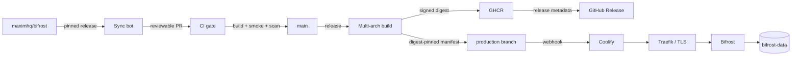
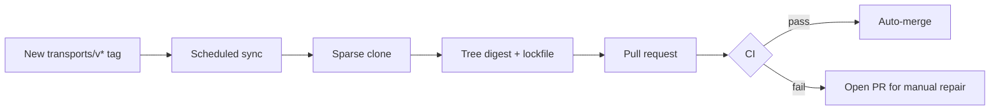

# Bifrost Distribution

**A reproducible, supply-chain-hardened distribution of the Bifrost AI Gateway,
built for production and designed for Coolify.**

[](https://github.com/OWNER/REPO/actions/workflows/ci.yml)
[](https://github.com/OWNER/REPO/actions/workflows/release.yml)
[](LICENSE)
[](https://go.dev/)
[](https://github.com/OWNER/REPO/pkgs/container/REPO)

---

## Why this repository exists

Upstream Bifrost ships fast. Operating it in production requires more than
pulling a mutable tag: it requires a pinned source snapshot, a reproducible
build, a vulnerability gate, a signed artifact, and a deployment path that
cannot silently advance past a failed build.

This repository provides that layer.

It is **not a fork**. The upstream source is vendored from a pinned
`transports/v*` release, verified against a tree digest, and promoted through a
gated release pipeline. Upstream behavior stays intact; the distribution adds
build hardening, release integrity, and a first-class Coolify deployment
contract.



## What the distribution guarantees

| Guarantee | Implementation |
|---|---|
| **Pinned upstream** | `upstream/` is mirrored from an upstream `transports/v*` tag and recorded in `vendor.lock.json` with commit, Git tree, file count, and SHA-256 tree digest. |
| **No unreviewed source drift** | CI recomputes the tree digest. Local edits to `upstream/` fail the build; fixes belong in `patches/`. |
| **Every release is built once** | Multi-stage Docker build, pinned base images, no build tooling in the runtime image. |
| **Every release is tested** | Startup smoke test, `/health` probe, version check, non-root assertion, and Trivy scan before promotion. |
| **Every release is signed** | Cosign keyless signing, BuildKit provenance, and an SPDX SBOM attached to the GitHub release. |
| **Production is immutable** | The `production` branch pins an image digest, never a mutable tag. |
| **Failed builds cannot deploy** | A failed CI, scan, signing, or release step leaves the production branch and Coolify untouched. |
| **Coolify is first-class** | A generated Compose manifest with persistent storage, resource limits, log rotation, health checks, and hardened container options. |

## Quick start

### Docker

```bash
export BIFROST_ENCRYPTION_KEY="$(openssl rand -hex 32)"
export BIFROST_SETUP_TOKEN="$(openssl rand -hex 32)"

docker run -d \
  --name bifrost \
  -p 127.0.0.1:8080:8080 \
  -v bifrost-data:/app/data \
  -e BIFROST_ENCRYPTION_KEY \
  -e BIFROST_SETUP_TOKEN \
  ghcr.io/OWNER/REPO:v2.4.0
```

Open `http://localhost:8080`, create the first administrator with the setup
token, and enable dashboard password protection.

### Docker Compose

```bash
docker compose up -d --build
```

The local stack listens on `127.0.0.1:8080` and persists state in the
`bifrost-data` volume.

### Coolify

Create a **Docker Compose** resource connected to the `production` branch, set
`BIFROST_ENCRYPTION_KEY` and `BIFROST_SETUP_TOKEN`, add a domain on port `8080`,
and deploy. The `production` branch is created by the first successful release;
run the **Release** workflow once if it is not present yet.

The complete walkthrough, including private GHCR access, backups, TLS, and
rollback, is in [docs/coolify.md](docs/coolify.md).

## Release integrity

```bash
IMAGE="ghcr.io/OWNER/REPO@sha256:<digest>"

cosign verify "$IMAGE" \
  --certificate-identity-regexp '^https://github.com/OWNER/REPO/' \
  --certificate-oidc-issuer https://token.actions.githubusercontent.com

docker buildx imagetools inspect "$IMAGE"
```

Each GitHub release includes:

- The immutable image digest.
- A multi-architecture manifest for `linux/amd64` and `linux/arm64`.
- An SPDX JSON SBOM.
- Build provenance and SBOM attestations.
- A Cosign signature tied to the GitHub Actions workflow identity.

## Upstream synchronization



The sync workflow runs four times per day and on demand. It:

1. Resolves the latest stable upstream gateway tag.
2. Performs a blobless sparse clone of that tag.
3. Excludes upstream CI metadata and hosted documentation media.
4. Recomputes the vendored tree digest.
5. Opens a pull request with the release metadata and path summary.

A pull request that fails any required check cannot merge. If auto-merge is
unavailable, the pull request remains ready for a maintainer to merge after the
checks pass.

Manual controls:

```bash
make sync                                  # latest stable upstream release
make sync-ref REF=transports/v2.4.0        # explicit release
python3 scripts/sync_upstream.py --dry-run # inspect without writing
make verify                                # tree integrity + distribution tests
```

See [docs/upstream-sync.md](docs/upstream-sync.md) for the full model.

## Versioning

Distribution releases mirror upstream gateway versions:

| Upstream tag | Distribution tag |
|---|---|
| `transports/v2.4.0` | `v2.4.0` |
| `transports/v2.4.0-rc.1` | `v2.4.0-rc.1` |

A distribution-only rebuild increments the revision:

```text
v2.4.0-distro.2
```

Production always deploys a digest, not a tag. See
[docs/versioning.md](docs/versioning.md).

## Runtime contract

| Property | Value |
|---|---|
| HTTP port | `8080` |
| Health | `GET /health` |
| Version | `GET /api/version` |
| Metrics | `GET /metrics` when Prometheus telemetry is enabled |
| Data directory | `/app/data` |
| Runtime user | `10001:10001` |
| Persistent state | `config.db`, `logs.db`, optional `config.json` |
| Shutdown | `SIGTERM`, forwarded by TINI, 45-second container grace period |

### Configuration

| Variable | Default | Purpose |
|---|---|---|
| `APP_PORT` | `8080` | HTTP listener port |
| `APP_HOST` | `0.0.0.0` | Bind address |
| `APP_DIR` | `/app/data` | Data directory |
| `LOG_LEVEL` | `info` | `debug`, `info`, `warn`, `error` |
| `LOG_STYLE` | `json` | Structured production logs |
| `BIFROST_SETUP_TOKEN` | none | First-administrator bootstrap token |
| `BIFROST_ENCRYPTION_KEY` | none | Stable key for encrypted credentials |
| `GOGC` | `100` | Go GC target; `200` is a common production value |
| `GOMEMLIMIT` | none | Soft Go memory limit; about 90% of container memory |

The complete deployment contract, including PostgreSQL guidance and sizing, is
in [docs/operations.md](docs/operations.md).

## Repository layout

```text
.
├── upstream/                  # Vendored upstream source (immutable snapshot)
├── patches/                   # Reviewed distribution patches (normally empty)
├── docker/                    # Runtime helper scripts
├── deploy/coolify/            # Coolify Compose template and environment reference
├── scripts/                   # Sync, verification, rendering, smoke tests
├── tests/                     # Distribution unit tests
├── docs/                      # Architecture, operations, and deployment guides
├── .github/workflows/         # CI, sync, release, and advisory upstream tests
├── Dockerfile                 # Production multi-stage build
├── compose.yaml               # Local development stack
├── vendor.lock.json           # Upstream provenance and tree digest
└── versions.env               # Generated version variables
```

## Coolify deployment at a glance

| Setting | Value |
|---|---|
| Resource type | Docker Compose |
| Branch | `production` |
| Compose file | `/compose.yaml` |
| Service | `bifrost` |
| Internal port | `8080` |
| Domain | HTTPS, Coolify-managed certificate |
| Storage | Named volume `bifrost-data` mounted at `/app/data` |
| Health check | Image-defined `GET /health` |
| Auto deploy | Coolify webhook triggered by the release workflow |

The `production` branch is generated and contains no source code. It exists to
describe exactly one verified image digest.

## Security

- Non-root runtime; the production Compose contract drops all capabilities and enables `no-new-privileges`.
- Pinned base images and Dependabot updates.
- Trivy gate for fixable `HIGH` and `CRITICAL` findings.
- Cosign keyless signatures and BuildKit provenance.
- SPDX SBOM for every release.
- Secrets are supplied by Coolify or an external secret manager, never baked
  into an image layer.

Report vulnerabilities through GitHub private advisories. See
[SECURITY.md](SECURITY.md).

## Operations

- [Architecture](docs/architecture.md)
- [Coolify deployment](docs/coolify.md)
- [Operations and incident response](docs/operations.md)
- [Upstream synchronization](docs/upstream-sync.md)
- [Repository settings](docs/repository-settings.md)
- [Troubleshooting](docs/troubleshooting.md)

## Contributing

Read [CONTRIBUTING.md](CONTRIBUTING.md). The short version:

- Do not edit `upstream/`.
- Put build or runtime fixes in the distribution layer.
- Use `patches/` only for reviewed, temporary deviations from upstream.
- Keep the verification checklist green.

## License and attribution

The distribution layer is licensed under the Apache License, Version 2.0. The
vendored Bifrost source is licensed under the Apache License, Version 2.0 by
Maxim AI and the Bifrost contributors. See [LICENSE](LICENSE),
[NOTICE](NOTICE), and [THIRD_PARTY_NOTICES.md](THIRD_PARTY_NOTICES.md).

Bifrost is a trademark of its respective owner. This repository is an
independent distribution and is not endorsed by or affiliated with Maxim AI.
