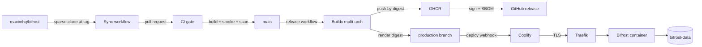
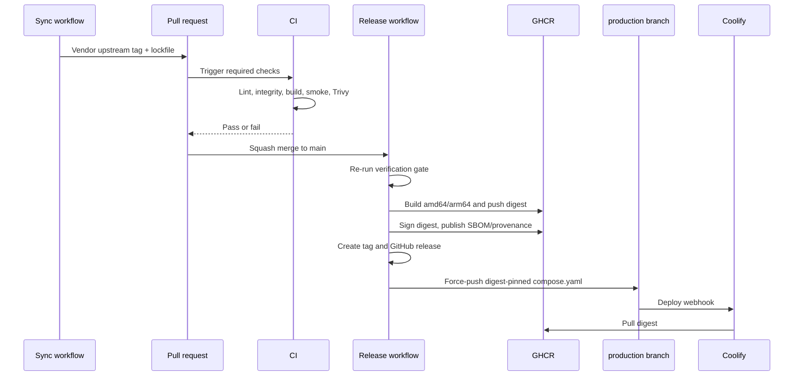

# Architecture

## Purpose

This repository turns an upstream Bifrost gateway release into a reproducible,
scanned, signed, multi-architecture container image and promotes it to a
production deployment without manual image handling.

The design has one non-negotiable property: **a failed build or verification
never changes what production runs.**

## System view

## Branches

| Branch | Contract |
|---|---|
| `main` | Human-reviewed source, build definitions, tests, and release automation. Protected. |
| `production` | Generated, minimal deploy branch. Contains `compose.yaml`, `release.json`, and a README. Coolify watches this branch. |
| `automation/upstream-v*` | Ephemeral synchronization branches created by the sync workflow. |

The `production` branch is orphaned and force-pushed on every successful
release. It deliberately has no source history, no secrets, and no build logic.
Its only job is to describe one immutable image digest.

## Release pipeline

If any gate fails, the workflow stops. The image may exist in GHCR as an
unpromoted artifact, but the `production` branch and Coolify deployment do not
move.

## Build stages

The `Dockerfile` has three build stages and one runtime stage:

1. **source** — exports the vendored tree, applies optional `patches/`, and
   produces a single immutable source layer.
2. **ui-builder** — runs `npm ci` and `npm run build-enterprise`.
3. **go-builder** — compiles `bifrost-http` with CGO, statically linked SQLite,
   and the upstream version embedded in the binary.
4. **runtime** — Alpine with CA certificates, timezone data, TINI, and the
   compiled binary. Runs as `10001:10001` with a read-only application layer.

The runtime image does not contain a compiler, Node.js, the Go toolchain, or
upstream build dependencies.

## Trust boundaries

| Boundary | Control |
|---|---|
| Upstream source | Pinned tag, commit, Git tree, and SHA-256 tree digest in `vendor.lock.json` |
| Build inputs | Base images pinned by digest; Dependabot proposes updates |
| Build output | Trivy gate for fixable `HIGH` and `CRITICAL` findings |
| Registry artifact | Multi-arch manifest, BuildKit provenance, SPDX SBOM, Cosign signature |
| Production promotion | Digest-pinned `production` branch, optional protected GitHub environment |
| Runtime | Non-root user; production Compose drops capabilities and enables `no-new-privileges`; image health check |
| Secrets | Coolify environment, never repository files or image layers |

## Runtime topology

A single Bifrost container with SQLite is the default production shape:

- HTTP listener on `8080`, reached only through the Coolify proxy network.
- Persistent named volume at `/app/data` containing `config.db`, `logs.db`, and
  optional `config.json`.
- Outbound access to model providers, MCP servers, identity providers, and
  observability endpoints.
- No inbound access except the proxy.

For multiple replicas, use PostgreSQL for both the config and log stores. OSS
Bifrost with a PostgreSQL config store still runs one replica because live
in-memory configuration is not synchronized between OSS processes. Enterprise
clustering is outside the scope of this distribution.

## Failure philosophy

- **Fail closed on deployment:** no successful image, no production branch
  update.
- **Fail visible on synchronization:** a failed sync leaves an open pull request
  with logs and a diff.
- **Fail recoverably:** the previous digest remains in the `production` branch
  history and in Coolify's rollback list.
- **No silent patching:** distribution patches are explicit files with a removal
  condition, never local edits to `upstream/`.
