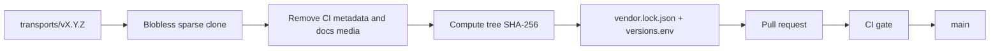

# Upstream Synchronization

## Model

The upstream repository is vendored as a snapshot, not used as a Git submodule
and not forked. This keeps the distribution independent of upstream branch
history while making every upstream change explicit and auditable.



## Source selection

The gateway image is built from upstream `transports/v*` tags. Other upstream
tags (`core/`, `framework/`, `plugins/`) are component releases and do not
correspond to a gateway image. The sync workflow resolves the latest stable
`transports/v*` tag, or accepts an explicit tag through manual dispatch.

Prerelease tags are excluded by default. They can be synced explicitly with
`--include-prerelease`.

## Mirror contents

Everything in the upstream tag is mirrored except:

| Excluded | Reason |
|---|---|
| `.github/` | Upstream CI workflows must not run in this repository. |
| `docs/media/` | Large hosted documentation media is not needed for the build. |
| `.claude/`, `.greptile/`, maintainer metadata | Tool-specific upstream maintainer configuration. |
| `.coderabbit.yaml`, `.snyk`, `.infisical.json`, `.envrc` | Upstream service configuration. |
| `AGENTS.md`, `pulse.yaml` | Upstream maintainer-only guidance. |

The exclusion list is part of `vendor.lock.json` so the mirror is auditable.

## Lockfile

`vendor.lock.json` records:

- Upstream repository, tag, version, commit, and Git tree SHA.
- Source and release URLs.
- Vendored directory, file count, SHA-256 tree digest, and exclusions.
- Distribution revision and generator.

`versions.env` is generated from the lockfile for shell and Makefile use. The
lockfile is the source of truth.

## Integrity checks

`scripts/verify_vendor.py` recomputes the tree digest over paths, modes, and
contents. CI fails if the vendored tree differs from the lockfile. This prevents
an unreviewed local edit from being built into an image.

If a local change is required, it must become a file under `patches/`. The
Docker build applies patches in a dedicated source stage, so the vendored tree
remains pristine and verifiable.

On POSIX systems the sync script marks vendored files read-only (`0444`) after
writing them. This prevents IDE module auto-tidy, `go mod tidy`, and accidental
edits from rewriting upstream `go.mod` and `go.sum` files. Directories remain
writable so the next sync can replace the tree; the Docker build runs as root
and can still apply reviewed patches. The tree digest covers content and the
executable bit, not the read-only bit.

## Automation

`.github/workflows/sync-upstream.yml` runs four times per day and on manual
dispatch:

1. Resolve the latest stable upstream tag.
2. Stop if the lockfile already pins that tag.
3. Sparse-clone the tag.
4. Replace `upstream/`, `vendor.lock.json`, and `versions.env`.
5. Push an `automation/upstream-v*` branch.
6. Open or update a pull request.
7. Enable squash auto-merge.

Branch protection keeps the pull request open until CI passes. If auto-merge is
not enabled, the pull request remains ready for a maintainer to merge after
checks.

## Manual synchronization

```bash
# Latest stable release
make sync

# Explicit release
make sync-ref REF=transports/v2.4.0

# Inspect without writing
python3 scripts/sync_upstream.py --ref transports/v2.4.0 --dry-run

# Rebuild the same upstream version with a new distribution revision
python3 scripts/sync_upstream.py --ref transports/v2.4.0 --force
```

After a forced re-sync, run `make bump-revision` before releasing if the
resulting image must have a new distribution tag.

## Failure handling

| Failure | Result |
|---|---|
| Upstream clone fails | Sync job fails; `main` and production are untouched. |
| Tree digest mismatch | CI fails; the pull request remains open. |
| Docker build fails | CI fails; no release or production promotion. |
| Smoke test fails | CI fails; no release or production promotion. |
| Vulnerability gate fails | Release stops after image push; production is untouched. |
| Signing or SBOM fails | Release stops; production is untouched. |
| Coolify webhook fails | The production branch is updated; redeploy manually or rerun the trigger. |

## Release tags

Every successful release creates:

- `vX.Y.Z` — distribution release tag, mirroring the upstream gateway version.
- `upstream/transports/vX.Y.Z` — anchor tag pointing to the vendored snapshot
  commit used for the release.

If a build-only change requires a new image for the same upstream version, the
distribution revision increments and the tag becomes `vX.Y.Z-distro.N`.
